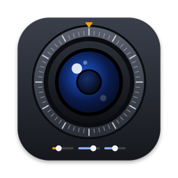

<p align="center">
  
</p>

<h1 align="center">Webcam Settings</h1>

<p align="center">
  A small macOS app to adjust focus, exposure and color on any USB (UVC) webcam,<br>
  with a live preview and settings that stick.
</p>

---

macOS has no settings panel for external webcams: if yours keeps hunting for focus, looks too dark or has the wrong
colors, you are usually stuck with the automatic behavior. **Webcam Settings** talks to the camera directly using
standard USB Video Class requests, so it works with most USB webcams without extra drivers.

## What you can adjust

The app only shows the controls your webcam reports as supported.

| Group | Controls |
| --- | --- |
| **Focus & zoom** | Autofocus, manual focus, zoom |
| **Exposure** | Auto or manual exposure, gain, backlight compensation, anti-flicker (50/60 Hz) |
| **Color & image** | Auto white balance or manual color temperature, brightness, contrast, saturation, hue, gamma, sharpness |

## Features

- **Live preview** next to the controls, so you see the effect of every change right away.
- **One-gesture focus lock**: let the camera focus automatically, then turn autofocus off. Focus stays exactly where it
  landed. The same works for exposure and white balance.
- **Saved settings**: every change is remembered and reapplied when the app opens, since many webcams reset to factory
  values when unplugged or when the Mac restarts.
- **Restore defaults** with one click, or right-click a single slider.
- **English and Italian** interface, following the system language.

## Requirements

- macOS 14 Sonoma or later
- Xcode or the Command Line Tools (`xcode-select --install`) to build
- A UVC-compatible USB webcam (nearly every external webcam)

## Install

```bash
git clone https://github.com/fabioferrero90/webcam-settings.git
cd webcam-settings
./build.sh
cp -R "build/Webcam Settings.app" /Applications/
```

On first launch macOS asks for camera access: it is needed for the preview.

The app is not signed with an Apple Developer certificate (ad-hoc signature only), so build it locally as shown above.

## How it works

| File | Role |
| --- | --- |
| [`uvc.c`](uvc.c) / [`uvc.h`](uvc.h) | Finds the first UVC webcam with IOKit, parses the USB descriptor to locate the camera terminal and processing unit, and sends `GET_CUR`/`SET_CUR`/`GET_MIN`/`GET_MAX`/… requests on the control endpoint |
| [`main.swift`](main.swift) | SwiftUI interface, AVFoundation preview, and settings persistence in `UserDefaults` (per vendor/product ID) |
| [`it.lproj/`](it.lproj) | Italian localization |
| [`make-icon.swift`](make-icon.swift) | Draws the app icon with AppKit |
| [`build.sh`](build.sh) | Compiles everything with `clang` and `swiftc` and assembles the `.app` bundle with icon and ad-hoc signature |

No Xcode project is needed: everything builds from the terminal.

## Known limitations

- The **first** UVC webcam found is used; there is no camera picker yet when several are connected.
- Some webcams only accept manual settings while streaming video: that is why the app opens the preview and reapplies
  saved settings after a moment.
- Built-in Mac cameras are not UVC devices and are not supported.

## License

[MIT](LICENSE)
